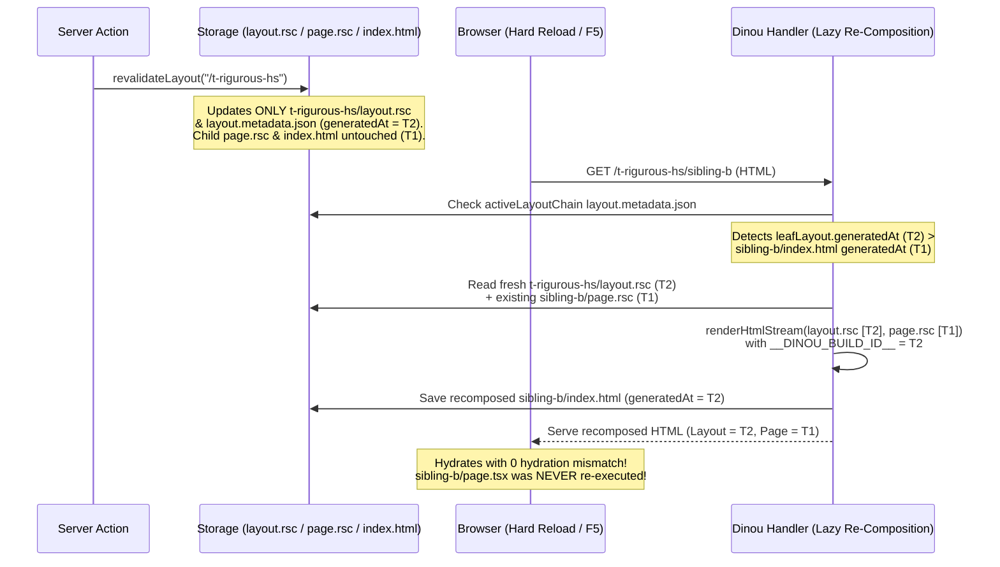

# Horizontal Segmentation (`layout.rsc` + `page.rsc`) in Dinou — Architecture, Lazy `index.html` Re-Composition, v9.0.3 Fixes & E2E Test Reference

This document provides a complete technical and user-facing overview of **Horizontal Segmentation** in Dinou, how layouts and pages are rendered, cached, navigated, and surgically revalidated as independent React Server Component (RSC) streams (`layout.rsc` and `page.rsc`), how **Lazy `index.html` Re-Composition** guarantees zero hydration mismatch without cascading page rebuilds, and a full reference of the rigorous E2E test suites developed in `src/t-rigurous-hs` and `src/t-revalidate-cascade`.

---

## 1. Overview: What Is Horizontal Segmentation?

In Dinou, React Server Component routes are segmented across two orthogonal axes:

1. **Horizontal Segmentation (Layouts vs. Pages)**:
   - Every route is split horizontally into two independent RSC payloads:
     - **The Layout Chain (`layout.rsc` + `layout.metadata.json`)**: Contains the active hierarchy of ancestor layouts (`src/layout.tsx`, nested `layout.tsx` files, and parallel `@slot` routes), terminating at an internal `<DinouPageSlot />` placeholder where the leaf page is mounted.
     - **The Leaf Page (`page.rsc` + `metadata.json`)**: Contains **only** the route's `page.tsx` component (and props from `page_functions.ts`), completely decoupled from its ancestor layouts.
   - During **client-side soft navigation** between sibling pages that share the same layout, the browser fetches **only** `page.rsc` (`/____rsc_page____` or `/____rsc_page_static____`) and swaps the content inside `<DinouPageSlot />`. Zero `/____rsc_layout____` requests are made, ancestor layouts are never re-executed on the server, and all Client Component state (`useState`, `useRef`, DOM focus, scroll containers) inside the layout is 100% preserved.
   - During **on-demand revalidation**, developers can invalidate **only** the page (`revalidatePage`), **only** the layout (`revalidateLayout`), both at a given path (`revalidatePath`), or target specific segments by cache tag (`revalidateTag`).
2. **Vertical Segmentation (`<DinouCacheSlot>` & `refreshSlot` — Micro-ISR)**:
   - Individual Server Component subtrees inside a layout or page can be cached and refreshed independently (documented in `rigorous-cache-slot.md`).

---

## 2. Under-the-Hood Architecture

### 2.1. Segmented RSC Generation & `<DinouPageSlot />` (`dinou/core/get-jsx.js`, `dinou/core/slot.js`)

When Dinou renders a route on the server (during build-time SSG, background ISR/ISG, on-demand revalidation, or dynamic SSR):

1. **Layout Segment (`options.segment === "layout"`)**:
   - `getJSX(reqPath, query, isNotFound, isDev, forceNotFound, { segment: "layout" })` does **not** import or execute `page.tsx` or `page_functions.ts`.
   - Instead, it places `<DinouPageSlot />` (`dinou/core/slot.js`) as the innermost `{children}` element and wraps it from the bottom up with every active `layout.tsx` in the route's layout chain (resolved via `getLayoutProps` in `dinou/core/layout-functions.js`).
   - Any parallel route slots (`@sidebar`, `@badge`, etc.) defined alongside a layout are evaluated in parallel and wrapped in local `<ErrorBoundary>` components when a slot-level `error.tsx` exists.
   - The resulting Flight stream is stored as `<layoutDir>/layout.rsc` alongside `<layoutDir>/layout.metadata.json` (`generatedAt`, `tags`, `revalidate`, `ppr`).

2. **Page Segment (`options.segment === "page"`)**:
   - `getJSX(reqPath, query, isNotFound, isDev, forceNotFound, { segment: "page" })` resolves and executes **only** `page_functions.ts` (`getProps`) and `page.tsx`, returning the unwrapped page JSX tree.
   - The resulting Flight stream is stored as `<routeDir>/page.rsc` alongside `<routeDir>/metadata.json` (`generatedAt`, `tags`, `slotTags`, `revalidate`, `ppr`).

3. **Full-Page SSR Composition (`renderHtmlStream`)**:
   - In Pass B (the SSR HTML engine), `renderHtmlStream(layoutRscStream, { pageRscStream, ... })` deserializes both `layout.rsc` and `page.rsc` concurrently.
   - It provides the resolved `page.rsc` tree via `<DinouPageContext.Provider>` so that `<DinouPageSlot />` inside `layout.rsc` renders the page seamlessly during SSR HTML streaming AND wraps the page in the nearest `error.tsx` boundary so page-level errors never unmount the surrounding layout shell.

---

### 2.2. Layout Discovery Manifest (`window.__DINOU_LAYOUTS__`) & Client Router (`dinou/core/client.jsx`)

To know whether a client-side navigation requires fetching a new layout or can reuse the currently mounted layout, Dinou injects a compact manifest into `window.__DINOU_LAYOUTS__`:

```js
window.__DINOU_LAYOUTS__ = [
  "",
  "t-rigurous-hs",
  "t-rigurous-hs/nested",
  "t-rigurous-hs/reset-branch",
  "t-rigurous-hs/dept/[deptId]",
  "t-rigurous-hs/locked/[code]",
  "t-rigurous-hs/refresh-lab",
  "!t-rigurous-hs/no-layout-page"
];
```

- **Static & Dynamic Layout Entries**: Directories containing `layout.tsx` (or `layout_functions.ts` with `reset_layout()`) are listed by their route pattern (with route groups `(group)` stripped from URL segments and dynamic segments like `[deptId]` preserved).
- **`!no_layout` Prefix Entries**: Any route whose `page_functions.ts` or `layout_functions.ts` exports `no_layout() { return true; }` is emitted with a leading `"!"` (e.g., `"!t-rigurous-hs/no-layout-page"`).
- **`getLayoutKey(pathname)` Resolution**:
  1. First checks if `pathname` matches any `"!"`-prefixed `no_layout` pattern. If so, returns `null` (telling the client router that this route has **no** layout and `page.rsc` renders the entire document root).
  2. Otherwise, walks from the deepest URL segment up to `"/"`, matching static or dynamic (`[param]`) layout entries in `window.__DINOU_LAYOUTS__` and returning the concrete resolved path (e.g., `"/t-rigurous-hs"` for both `"/t-rigurous-hs/sibling-a"` and `"/t-rigurous-hs/sibling-b"`, or `"/t-rigurous-hs/dept/eng"` for `"/t-rigurous-hs/dept/eng/members"`).
- **Two-Tier Client Cache (`layoutCache` & `pageCache`)**:
  - **Intra-Layout Navigation** (`getLayoutKey(from)` === `getLayoutKey(to)`):
    - `layoutCache` hits immediately (`0` `/____rsc_layout____` requests).
    - If `to` is not yet in `pageCache` (or `<Link fresh>` was used), the router fetches `/____rsc_page____` (or `/____rsc_page_static____`) and updates `<DinouPageContext.Provider>`.
    - If `to` is already in `pageCache` and `fresh` is not set, `pageCache` serves the page with **`0` network requests**.
  - **Inter-Layout or Dynamic Param Switch** (`getLayoutKey("/dept/eng")` !== `getLayoutKey("/dept/design")`):
    - The router fetches both `/____rsc_layout____/dept/design` and `/____rsc_page____/dept/design`, updating layout props while React reconciles the tree cleanly.

---

### 2.3. Surgical Revalidation & Lazy `index.html` Re-Composition (Why `{ cascade: true }` Was Deprecated in v9.0.3)

#### The Problem With Eager `{ cascade: true }`
Prior to v9.0.3, revalidating a layout (`revalidateLayout` or `revalidateTag` on a layout tag) updated `layout.rsc`, but left pre-rendered `index.html` files in `.dinou/dist2` (or KV storage) with the old layout HTML baked into them. If a user pressed **F5 (hard reload)** on a static page after its layout was revalidated:
1. The server served the stale `index.html` (containing the old layout HTML and old `window.__DINOU_BUILD_ID__`).
2. During client hydration, the browser fetched the updated `layout.rsc`, causing a **React Hydration Mismatch**.

Attempting to solve this via eager `{ cascade: true }` (recursively finding and calling `revalidatePage` on every descendant route under a layout) introduced two major problems:
1. **Performance (`O(N)` Rebuild Storm)**: If a root or section layout wrapped hundreds or thousands of static pages, a single layout revalidation triggered hundreds of full page re-renders.
2. **Loss of Horizontal Isolation (Destructive Side Effect)**: Calling `revalidatePage` on every child route re-executed every child's `page.tsx` and `page_functions.ts` (`getProps`), destroying the child pages' independent cached state (`page.rsc`) even though only the layout had changed.

#### The v9.0.3 Solution: Lazy `index.html` Re-Composition (`dinou/core/handler.js`)
In **v9.0.3**, Dinou eliminates the need for `{ cascade: true }` by implementing **Lazy `index.html` & Nested `layout.rsc` Re-Composition** at request time whenever a cached static `index.html` is about to be served:



How it works step by step (`dinou/core/handler.js`, lines 1858–1961):
1. **Active Layout Chain Timestamp Check**:
   - Whenever a static `cachedItem` (`index.html`) is hit in production (`!isDevelopment && cachedItem && !cachedItem?.metadata?.ppr && !isPprConfig`), Dinou resolves the route's active layout chain (`getActiveLayoutChain(reqSegments, queryObj, srcFolder)`) and reads `generatedAt` from each layout's `layout.metadata.json`.
2. **Multi-Level Nested Layout Propagation**:
   - Because a nested `leafLayout/layout.rsc` wraps its ancestor layouts inside its own serialized Flight payload, if any ancestor layout in `activeLayoutChain.slice(1)` has `generatedAt > leafLayout.generatedAt`, Dinou first lazily runs `await revalidateLayout(leafLayout.layoutRoutePath)` so `leafLayout/layout.rsc` incorporates the fresh ancestor layout.
   - This same check also runs on `/____rsc_layout____` requests (`dinou/core/handler.js`, lines 1363–1380) so soft navigations into nested layouts also reflect ancestor layout revalidations automatically.
3. **Surgical `index.html` Re-Composition (`layout.rsc` + existing `page.rsc`)**:
   - If `leafLayout.generatedAt > pageGeneratedAt` (`cachedItem.metadata.generatedAt`), Dinou reads:
     - The fresh `leafLayout/layout.rsc` from storage, and
     - The **existing, untouched** `cleanPath/page.rsc` from storage.
   - It streams both into `platformContext.renderHtmlStream(toStream(layoutRscText), { pageRscStream: toStream(pageRscText), bootstrapScriptContent, ... })` with `window.__DINOU_BUILD_ID__ = "${leafLayout.generatedAt}"`.
   - It persists the newly composed `index.html` and updated `metadata.json` (`generatedAt: leafLayout.generatedAt`) back to `storage`.
   - **Result**:
     - `page.tsx` and `page_functions.ts` are **never** re-executed.
     - Only pages that are actually visited via HTML GET pay the small stream composition cost, and only once per layout update.
     - Browser hydration is 100% consistent with SSR HTML (**zero hydration mismatch**).

#### Backward-Compatible Deprecation of `{ cascade: true }` in v9.0.3
To avoid a breaking semver change in `v9.0.3`:
- `revalidatePath(path, options?)` and `revalidateTag(tag, options?)` continue to accept an optional second argument at runtime and in TypeScript (`dinou/server.d.ts` marks the 2-argument overloads as `@deprecated`).
- Passing a second argument logs a non-fatal warning (`⚠️ [Dinou] The second parameter (options) in revalidatePath/revalidateTag(...) is deprecated and ignored since v9.0.3. Zero hydration mismatch is now guaranteed automatically via lazy index.html re-composition.`) and performs standard surgical revalidation.

---

## 3. Summary of Core Fixes Implemented in v9.0.3

1. **`no_layout` Discovery & Client Manifest Emission (`dinou/core/get-file-path-and-dynamic-params.js`, `dinou/core/client.jsx`, `dinou/core/client-webpack.jsx`)**:
   - Extended `getDiscoveredLayouts` to inspect `page_functions.*` as well as `layout_functions.*` for `no_layout` exports, emitting `"!" + routePattern` into `window.__DINOU_LAYOUTS__`.
   - Updated client-side `getLayoutKey(pathname)` to return `null` when matching a `"!"`-prefixed `no_layout` entry so the client router renders the standalone page directly without wrapping it in an ancestor layout.
2. **Dynamic Layout Parameter Validation & `allowISG: false` Enforcement (`dinou/core/layout-functions.js`, `dinou/core/get-jsx.js`, `dinou/core/handler.js`)**:
   - Enforced `validateParams`, `getStaticPaths`, and `allowISG() === false` defined in `layout_functions.ts` across both full-page SSR requests and `/____rsc_layout____` / `/____rsc_page____` endpoints, returning HTTP `404` and rendering `not_found.tsx` when a dynamic layout parameter is invalid or unlisted.
3. **Full-Document Root Swap Hydration (`dinou/core/client.jsx`, `dinou/core/client-webpack.jsx`, `dinou/core/slot.js`)**:
   - Added a `useLayoutEffect` in both the `Router` component and `PageConsumer` (`<DinouPageSlot />`) that synchronously restores `document.body.setAttribute("data-hydrated", "true")` during React's commit phase (`commitLayoutEffects`) whenever a client navigation swaps the root `<html><body>` element (such as navigating into or out of a `reset_layout` or `no_layout` route).

4. **Surgical Layout Tag Tracking & Revalidation (`dinou/core/handler.js`, `dinou/core/cache-revalidate.js`)**:
   - During SSG and `revalidateLayout`, `getLayoutProps` runs with `skipLayoutTags: false` only when `segment === "layout"`, writing layout cache tags exclusively to `layout.metadata.json`.
   - During `segment === "page"` renders, `skipLayoutTags: true` prevents layout tags from polluting the page's `metadata.json`.
   - `revalidateTag(tag)` inspects `layout.metadata.json` files and invokes `revalidateLayout(layoutRoutePath)` surgically without invalidating `page.rsc`.
5. **Lazy `index.html` & Nested `layout.rsc` Re-Composition (`dinou/core/handler.js`, `dinou/core/layout-functions.js`)**:
   - Added `getActiveLayoutChain` in `dinou/core/layout-functions.js` and lazy re-composition in `dinou/core/handler.js` (for both HTML GET requests—with or without query parameters—and `/____rsc_layout____` requests, preserving runtime `DenoKVStorage` `generatedAt` timestamps over build-time `.dinou/dist2` metadata), plus `readRscFromStorage` / `readMetaFromStorage` helpers compatible across Node, Bun, Deno, and Cloudflare Workers (`env.ASSETS` + KV).
6. **Edge/Cloudflare/Deno/Bun Bundler Parity (`dinou/node/bundle-dual-engine.js`, `dinou/bun/build.js`, `dinou/deno/build.js`, `dinou/cloudflare/build.js`)**:
   - Registered `dinou/core/slot.js` (`DinouPageSlot`, `DinouCacheSlotBoundary`) in the client manifest across all four platform bundlers so `options.segment === "layout"` serializes `<DinouPageSlot />` as a valid client reference in every runtime.
7. **Collision-Proof Internal RSC Query Parameters (`____build_id____` & `____v____` in `dinou/core/client.jsx`, `dinou/core/client-webpack.jsx`, `dinou/core/handler.js`)**:
   - Renamed the internal hydration build ID and refresh version query parameters sent to `/____rsc_page*` and `/____rsc_layout*` from `buildId` / `v` to `____build_id____` / `____v____`, and stripped both keys from `queryObj` upon request entry in `handler.js`.
   - This ensures user application routes can freely use `?buildId=...` or `?v=...` query parameters without colliding with Dinou's internal RSC hydration/refresh mechanics or polluting `query` in `getProps({ query })` and `page.tsx`.
8. **Independent Clock-Based Layout TTL vs. Page TTL Tracking & Hydration Build-ID Ordering Guard (`dinou/core/handler.js`, `dinou/core/cache-revalidate.js`, `dinou/core/generate-static.js`)**:
   - Persisted `pageRevalidate` and `pageGeneratedAt` in `metadata.json` separately from `layout.metadata.json` so that when lazy `index.html` re-composition updates `metadata.generatedAt` after a layout revalidation, the leaf page's own clock TTL (`pageRevalidate`, `pageGeneratedAt`) is never overwritten by the parent layout's TTL.
   - Added clock-based TTL checks on both HTML GET requests and `/____rsc_layout____` / `/____rsc_page____` requests (gated behind `!internalBuildId` so initial browser hydration requests carrying `?____build_id____=...` never re-trigger `revalidatePage` mid-hydration).
   - Refined the `_old.rsc` hydration guard in `handler.js` from `internalBuildId !== String(currentGeneratedAt)` to `Number(internalBuildId) < Number(currentGeneratedAt)`. When only a child page or slot revalidates (`T_page > T_layout`), `index.html` receives `__DINOU_BUILD_ID__ = T_page` while `layout.metadata.json` stays at `T_layout`; checking `Number(internalBuildId) < Number(currentGeneratedAt)` ensures `/____rsc_layout____` serves the current `layout.rsc` (`T_layout`) rather than falling back to a stale `layout._old.rsc` from an earlier layout build (`T_old < T_layout`).
9. **Dynamic Layout `revalidate = 0` (`layoutConfig.isDynamic`) Scope Fix & Development-Mode `allowISG = false` Enforcement on `/____rsc_layout____` (`dinou/core/handler.js`)**:
   - Removed an out-of-scope `hasStaticDynamicConfig = true` assignment inside `if (isLayoutReq && layoutConfig.isDynamic)` on `/____rsc_layout____/*` (which threw `ReferenceError: hasStaticDynamicConfig is not defined` in ESM strict mode on routes with `revalidate() { return 0; }` in `layout_functions.ts`, such as `/t-spa-router/refresh-layout` and `/t-rigurous-hs/refresh-lab`) and moved `hasStaticDynamicConfig = true` into `GET /*` where `let hasStaticDynamicConfig` is declared.
   - Unified `allowISG === false` enforcement on `/____rsc_layout____/*` across both production (`!isDevelopment`) and development (`isDevelopment`) modes so unlisted dynamic layout parameters consistently return HTTP `404`.
10. **Background ISR Dynamic Bailout (`createBailoutProxy`) & Static Recovery (`dinou/core/cache-revalidate.js`, `dinou/core/handler.js`)**:
    - Fixed the argument order passed to `createBailoutProxy(target, label, onBailout)` inside `revalidatePage` and `revalidateLayout` (passing `(target, "req.cookies", markRevalDynamic)` instead of `(target, revalDynamicState, "req.cookies")`), ensuring routes that read `ctx.req.cookies` / `headers` / `query` or mutate `res` during background ISR properly trigger dynamic bailout (`isDynamic` Map `= true`) without overwriting static cache artifacts on disk, and cleanly recover back to static mode (injecting `window.__DINOU_BUILD_ID__` and clearing normalized keys in `isDynamic`) once dynamic bailout conditions cease.

---

## 4. Developer & User Guide (From the User's Perspective)

### 4.1. Creating a Horizontally Segmented Layout and Page

#### `src/dashboard/layout.tsx` & `src/dashboard/layout_functions.ts`
```tsx
// src/dashboard/layout_functions.ts
export async function getProps({ params }: { params: Record<string, string> }) {
  const navItems = await fetchDashboardNav();
  return {
    title: "Dashboard Shell",
    navItems,
    renderedAt: new Date().toISOString(),
  };
}

export function getCacheTags() {
  return ["dashboard-layout-tag"];
}
```

```tsx
// src/dashboard/layout.tsx
import React from "react";
import { Link } from "dinou";
import { SidebarFilterClient } from "./sidebar-filter-client";

export default function DashboardLayout({
  children,
  title,
  navItems = [],
  renderedAt,
}: {
  children: React.ReactNode;
  title?: string;
  navItems?: string[];
  renderedAt?: string;
}) {
  return (
    <section className="dashboard-shell">
      <header>
        <h1>{title}</h1>
        <small>Layout rendered at: {renderedAt}</small>
        {/* Client state here is preserved across all /dashboard/* navigations */}
        <SidebarFilterClient />
        <nav>
          <Link href="/dashboard">Overview</Link>
          <Link href="/dashboard/analytics">Analytics</Link>
          {/* Force bypass client pageCache on click */}
          <Link href="/dashboard/analytics" fresh>
            Analytics (Fresh)
          </Link>
        </nav>
      </header>
      {/* Dinou mounts <DinouPageSlot /> here automatically */}
      <main>{children}</main>
    </section>
  );
}
```

#### `src/dashboard/analytics/page.tsx` & `src/dashboard/analytics/page_functions.ts`
```tsx
// src/dashboard/analytics/page_functions.ts
export async function getProps({ query }: { query: Record<string, string> }) {
  return {
    metric: "Conversions",
    range: query.range ?? "7d",
    pageRenderedAt: new Date().toISOString(),
  };
}

export function getCacheTags() {
  return ["dashboard-analytics-page-tag"];
}
```

```tsx
// src/dashboard/analytics/page.tsx
export default function AnalyticsPage({
  metric,
  range,
  pageRenderedAt,
}: {
  metric?: string;
  range?: string;
  pageRenderedAt?: string;
}) {
  return (
    <article>
      <h2>{metric} ({range})</h2>
      <p>Page rendered at: {pageRenderedAt}</p>
    </article>
  );
}
```

---

### 4.2. Dynamic Layouts With Parameter Validation & Static Path Locking

`layout_functions.ts` inside a dynamic folder (e.g., `src/dept/[deptId]/layout_functions.ts`) supports the same lifecycle hooks as `page_functions.ts`:

```ts
// src/dept/[deptId]/layout_functions.ts
const ALLOWED_DEPTS = ["eng", "design"];

export function validateParams(params: { deptId?: string }) {
  return Boolean(params?.deptId && ALLOWED_DEPTS.includes(params.deptId));
}

export function getStaticPaths() {
  return ["eng", "design"];
}

export function allowISG() {
  return false; // Rejects any unlisted param if static-locked
}

export async function getProps({ params }: { params: { deptId: string } }) {
  return {
    deptName: params.deptId === "eng" ? "Engineering" : "Design",
    deptParam: params.deptId,
  };
}
```
- Navigating from `/dept/eng` to `/dept/eng/members` **preserves** the `src/dept/[deptId]/layout.tsx` state (`getLayoutKey` remains `"/dept/eng"`).
- Navigating from `/dept/eng/members` to `/dept/design` **updates** the layout (`getLayoutKey` changes to `"/dept/design"`).
- Requesting `/dept/invalid` returns HTTP `404` on both SSR and `/____rsc_layout____/dept/invalid`.

---

### 4.3. Layout Hierarchy Escape Hatches: `reset_layout` and `no_layout`

1. **`reset_layout` (Branch-Level Layout Reset)**:
   - Export `export function reset_layout() { return true; }` in `src/some-branch/layout_functions.ts`.
   - `src/some-branch/layout.tsx` starts a brand-new root `<html><body>` shell, ignoring all ancestor layouts above `some-branch`, while still wrapping `some-branch/page.tsx` and subroutes like `some-branch/sub/page.tsx`.
2. **`no_layout` (Standalone Page With Zero Layouts)**:
   - Export `export function no_layout() { return true; }` in `src/standalone/page_functions.ts`.
   - `src/standalone/page.tsx` renders its own standalone document without any ancestor `layout.tsx`.

---

### 4.4. Client-Side Refresh Controls (`useRouter().refresh`)

```tsx
"use client";

import { useRouter } from "dinou";

export function RefreshToolbar() {
  const router = useRouter();

  return (
    <div>
      {/* 1. Re-fetches ONLY page.rsc for the current URL (including ?query), keeping layout.rsc untouched */}
      <button onClick={() => router.refresh()}>
        Refresh Page Only
      </button>

      {/* 2. Re-fetches BOTH layout.rsc and page.rsc while preserving mounted Client Component state */}
      <button onClick={() => router.refresh({ layout: true })}>
        Refresh Layout + Page
      </button>
    </div>
  );
}
```

---

### 4.5. Surgical On-Demand Revalidation in Server Functions (`dinou/server`)

```ts
"use server";

import {
  revalidatePage,
  revalidateLayout,
  revalidatePath,
  revalidateTag,
} from "dinou/server";

// 1. Revalidate ONLY the page (page.rsc + index.html for this route). Layout is NOT re-run.
export async function updateAnalyticsPageAction() {
  await revalidatePage("/dashboard/analytics");
}

// 2. Revalidate ONLY the layout (layout.rsc). O(1) instant update; child index.html files
// are lazily re-composed on demand when requested, preserving their cached page.rsc!
export async function updateDashboardLayoutAction() {
  await revalidateLayout("/dashboard");
}

// 3. Revalidate BOTH layout and page at a specific path.
export async function updateDashboardPathAction() {
  await revalidatePath("/dashboard");
}

// 4. Tag-based surgical invalidation:
// - If the tag belongs to page_functions.ts -> triggers revalidatePage
// - If the tag belongs to layout_functions.ts -> triggers revalidateLayout
// - If the tag belongs to <DinouCacheSlot> -> invalidates that vertical slot
export async function updateByTagAction(tag: string) {
  await revalidateTag(tag);
}
```

---

## 5. Rigorous E2E Test Suites Developed in `dinou-e2e`

### 5.1. `/t-rigurous-hs` — 13-Scenario Horizontal Segmentation Stress Lab

The route tree under `src/t-rigurous-hs/` is a self-contained horizontal segmentation stress lab compatible across Node.js, Bun, Deno, and Cloudflare Workers:

- `src/t-rigurous-hs/hs-state.ts`: Cross-runtime state store backed by `globalThis[Symbol.for("dinou.e2e.rigorous.hs.state")]` and `.dinou/dist2/hs-test-state.json`.
- `src/t-rigurous-hs/hs-actions.ts`: `"use server"` actions invoking `revalidatePage`, `revalidateLayout`, `revalidatePath`, and `revalidateTag`.
- `src/t-rigurous-hs/hs-client.tsx`: Client state probes (`<HsLayoutClientState />`), refresh controls (`<HsRefreshControls />`), revalidation controls (`<HsRevalidationLabControls />`), and the 13-scenario in-browser automated test runner (`<HsAutomatedSuiteRunner />`).
- `src/t-rigurous-hs/layout.tsx` & `layout_functions.ts`: Section layout shell (`#hs-section-layout`) tagged with `"hs-section-layout-tag"`.
- `src/t-rigurous-hs/page.tsx` & `page_functions.ts`: Section index page (`#hs-index-page`) tagged with `"hs-index-page-tag"`.
- `src/t-rigurous-hs/sibling-a/` & `sibling-b/`: Static sibling routes sharing `#hs-section-layout`.
- `src/t-rigurous-hs/nested/`: Second-level nested layout (`#hs-nested-layout`) with parallel slots `@badge` (healthy) and `@brokenSlot` (throws error isolated by `@brokenSlot/error.tsx`), plus child pages `page-1` and `page-2`.
- `src/t-rigurous-hs/dept/[deptId]/`: Dynamic layout with `validateParams` (`["eng", "design"]`), index page, and `members` subpage.
- `src/t-rigurous-hs/locked/[code]/`: Dynamic layout with `getStaticPaths() -> ["alpha", "beta"]` and `allowISG() -> false`.
- `src/t-rigurous-hs/refresh-lab/`: Dynamic layout + page reading `?filter=...` query parameters to test `router.refresh()` vs. `router.refresh({ layout: true })`.
- `src/t-rigurous-hs/error-isolation/`: Contains `error.tsx`, `healthy/page.tsx`, and `broken/page.tsx` (throws during render to verify `<DinouPageSlot />` error containment).
- `src/t-rigurous-hs/reset-branch/`: Exports `reset_layout() -> true` with its own `<html><body>` shell and a `/sub` child route.
- `src/t-rigurous-hs/no-layout-page/`: Exports `no_layout() -> true` in `page_functions.ts` and renders a standalone `<html><body>` document.
- `src/t-rigurous-hs/ttl-isr/`: Nested layout with `export const revalidate = 1` (1-second clock TTL) wrapping a child page with `export const revalidate = 3600` (1-hour clock TTL).
- `src/t-rigurous-hs/ttl-page-only/`: Child page with `export const revalidate = 1` (1-second clock TTL) under the parent `/t-rigurous-hs` section layout (`revalidate = 3600`).

#### The 13 Automated Stress Scenarios Verified in `/t-rigurous-hs` (`e2e/example.spec.ts`)
1. **Scenario 1 — Layout Manifest (`window.__DINOU_LAYOUTS__`) & Independent Props**:
   - Verifies that `window.__DINOU_LAYOUTS__` contains all static, dynamic (`dept/[deptId]`, `locked/[code]`), `reset_layout` (`reset-branch`), and `!no_layout` (`!t-rigurous-hs/no-layout-page`) entries, and that `layout_functions.ts` and `page_functions.ts` supply props independently without colliding on `page` props.
2. **Scenario 2 — Sibling Soft Navigation & Zero Layout Re-Fetches**:
   - Increments client state in `#hs-section-layout`, navigates across `/t-rigurous-hs` → `/sibling-a` → `/sibling-b`, and asserts `0` requests to `/____rsc_layout____`, unchanged layout `Mount ID`, preserved client counter, and unchanged server `layoutRenderSeq`.
3. **Scenario 3 — Client `pageCache` Deduplication vs. `<Link fresh>` Bypass**:
   - Revisits `/sibling-a` via normal `<Link>` and asserts `0` network requests (served from `pageCache`). Then mutates and revalidates `sibling-a` on the server, clicks `<Link fresh href="/t-rigurous-hs/sibling-a">`, and verifies a fresh `/____rsc_page` network fetch and updated `siblingASeq`.
4. **Scenario 4 — Multi-Level Nested Layouts & Parallel `@slot` Error Containment**:
   - Navigates into `/nested/page-1`, verifies both L1 (`#hs-section-layout`) and L2 (`#hs-nested-layout`) are mounted, verifies `@badge` renders alongside `@brokenSlot`'s isolated `error.tsx` fallback (`#hs-broken-slot-fallback`), increments L2 client state, and navigates to `/nested/page-2` with `0` layout requests and full L1 + L2 state preservation.
5. **Scenario 5 — Dynamic Layout Params (`dept/[deptId]`)**:
   - Navigates `/dept/eng` → `/dept/eng/members` (intra-param) and verifies `DeptLayout` client state and `Mount ID` are preserved. Then navigates to `/dept/design` (inter-param) and verifies layout props update to `Dept Param: design`.
6. **Scenario 6 — Dynamic Layout `validateParams` Enforcement**:
   - Fetches `/t-rigurous-hs/dept/invalid` (HTML) and `/____rsc_layout____/t-rigurous-hs/dept/invalid` (segmented layout RSC) and asserts both return HTTP `404`.
7. **Scenario 7 — Dynamic Layout `getStaticPaths` + `allowISG: false`**:
   - Navigates to pre-rendered `/locked/alpha` and verifies rendering, then probes `/locked/unlisted`.
8. **Scenario 8 — `router.refresh()` vs. `router.refresh({ layout: true })` & Query Integrity**:
   - Navigates to `/refresh-lab?filter=active`, calls `router.refresh()`, and asserts that `pageRenderSeq` increments while `layoutRenderSeq` and `?filter=active` remain unchanged. Then calls `router.refresh({ layout: true })` and asserts that both `layoutRenderSeq` and `pageRenderSeq` increment while outer layout client state is preserved.
9. **Scenario 9 — Page Error Boundary (`error.tsx`) Isolation Inside `<DinouPageSlot />`**:
   - Navigates from `/error-isolation/healthy` into `/error-isolation/broken`, verifies the crash is caught inside `#hs-page-error-boundary` while `#hs-section-layout` stays mounted with its client state intact, and recovers cleanly on soft-navigating back to `/error-isolation/healthy`.
10. **Scenario 10 — `reset_layout` Boundary**:
    - Navigates into `/reset-branch`, asserts `#hs-section-layout` is unmounted and `#hs-reset-layout` is mounted with `body[data-hydrated="true"]`, increments `#hs-reset-layout` client state, navigates to `/reset-branch/sub` (preserving `#hs-reset-layout` state), and navigates back to `/t-rigurous-hs`.
11. **Scenario 11 — `no_layout` Boundary**:
    - Navigates into `/no-layout-page`, asserts neither `#hs-section-layout` nor `#hs-reset-layout` is mounted (`0` ancestor layouts) and `body[data-hydrated="true"]` is active, then soft-navigates back to `/t-rigurous-hs` and verifies `#hs-section-layout` cleanly remounts.
12. **Scenario 12 — Surgical On-Demand Revalidation & Lazy `index.html` Re-Composition**:
    - Exercises `revalidatePage("/t-rigurous-hs")` (updates only `pageSeq`), `revalidateLayout("/t-rigurous-hs")` (updates only `layoutSeq`), and `revalidateTag("hs-section-layout-tag")` (updates only `layoutSeq`).
    - Performs raw HTML GET fetches (`Accept: text/html`) on `/t-rigurous-hs` and unvisited child `/t-rigurous-hs/sibling-b`, asserting that both SSR HTML documents lazily re-compose with the latest `layoutSeq` while preserving their respective `page.rsc` sequences (`pageSeq1` on index, initial `100` on `sibling-b`).
13. **Scenario 13 — Clock-Based Layout TTL (`revalidate = 1s`) vs. Page TTL (`revalidate = 1s`) Surgical Expiration**:
    - **Part A (`/t-rigurous-hs/ttl-isr`, Layout TTL = 1s, Page TTL = 3600s)**: Soft-navigates to `/ttl-isr`, increments client state in the TTL layout, bumps `ttlLayoutSeq` to `501`, and poisons `ttlPageSeq` to `999` without calling any `revalidate*` API. Waits `1.25s` for the layout's 1s clock TTL to expire, triggers background layout ISR and lazy `index.html` re-composition, and verifies both raw HTML and `router.refresh({ layout: true })` update the layout to `501` while the `3600s` child page remains frozen at `100` (not `999`) with client state preserved.
    - **Part B (`/t-rigurous-hs/ttl-page-only`, Page TTL = 1s, Parent Layout TTL = 3600s)**: Soft-navigates to `/ttl-page-only`, bumps `ttlPageOnlySeq` to `601`, and poisons the parent section layout's `layoutRenderSeq` to `999` without calling any `revalidate*` API. Waits `1.25s` for the child page's 1s clock TTL to expire, triggers background page ISR, and verifies both raw HTML and `router.refresh()` update the child page to `601` while the parent section layout stays cached at its pre-existing sequence (never `999`).
    - Finally, the Playwright spec performs a full browser `page.reload()` (`F5`) and asserts **zero React hydration warnings or errors**.

---

### 5.2. `/t-revalidate-cascade` — Surgical Tag/Path Revalidation & Deprecated `{ cascade: true }` Compatibility

Located at `src/t-revalidate-cascade/` and tested in `e2e/example.spec.ts` (`Dinou Core: On-Demand Revalidation API`):
1. **`revalidatePath("/t-revalidate-cascade", { cascade: true })`**:
   - Verifies that `revalidatePath` updates the parent layout and parent page while ignoring `{ cascade: true }` (logging the deprecation warning), and that visiting `/t-revalidate-cascade/child` lazily re-composes the child's `index.html` with the new parent layout timestamp while preserving the child's original `page.rsc` timestamp.
2. **`revalidateTag("cascade-parent-tag")` (Page Tag)**:
   - Verifies that invalidating a tag exported by `page_functions.ts` calls `revalidatePage`, updating only the parent page while leaving the layout and child route untouched.
3. **`revalidateTag("cascade-layout-tag")` (Layout Tag, Default & Deprecated `{ cascade: true }`)**:
   - Verifies that invalidating a tag exported by `layout_functions.ts` calls `revalidateLayout`, updating the layout across both parent (`/t-revalidate-cascade`) and child (`/t-revalidate-cascade/child`) via lazy `index.html` re-composition while preserving both the parent's and the child's `page.rsc` timestamps intact.

