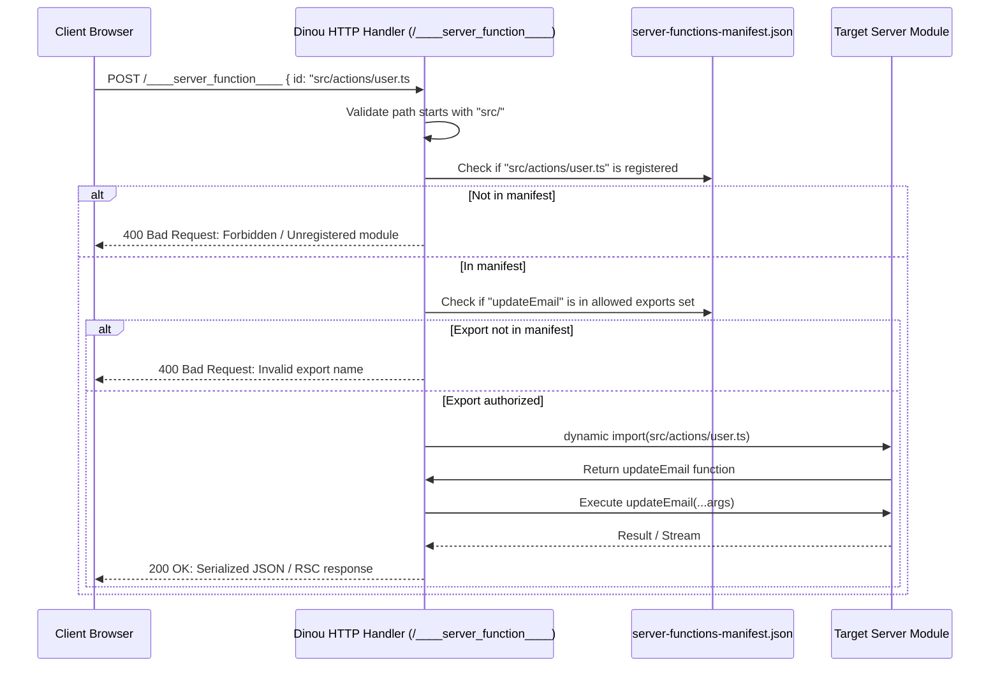

# Server Functions in Dinou: Comprehensive Guide & Architectural Reference

This document outlines the design, implementation, and user-facing semantics of **Server Functions** (also known as Server Actions) in **Dinou**, an enterprise-grade React 19 React Server Components (RSC) framework.

---

## 1. Introduction

Server Functions provide a seamless Remote Procedure Call (RPC) bridge between the client and server. In Dinou, a Server Function is an asynchronous JavaScript function that runs exclusively on the server but can be referenced, passed through props, and invoked directly from client-side code (event handlers, forms, hooks, etc.).

Dinou routes all client-initiated Server Function invocations through an internal, highly optimized HTTP endpoint:
```http
POST /____server_function____
```

Every invocation includes security validation against a compiled **`server-functions-manifest.json`**, ensuring that only authorized, reachable functions can be executed remotely.

Dinou supports two primary modalities for defining Server Functions:
1. **Module-level `"use server"`**
2. **Function-level `"use server"`** (including top-level functions in mixed files and inline closures inside Server Components).

---

## 2. Modality 1: Module-Level `"use server"`

### 2.1 Definition & Syntax
When placed as the very first statement of a file (before any imports or other code), the `"use server"` directive marks the entire file as a dedicated Server Functions module:

```typescript
// src/actions/user.ts
"use server";

export async function updateUserEmail(userId: string, newEmail: string) {
  // Runs exclusively on the server
  await db.users.update(userId, { email: newEmail });
  return { success: true };
}

export async function deleteUserAccount(userId: string) {
  // Runs exclusively on the server
  await db.users.delete(userId);
  return { success: true };
}
```

### 2.2 Key Characteristics & Manifest Inclusion Rules

1. **All Exports Become Server References:**
   - Every exported function in a module-level `"use server"` file is registered as a Server Reference with an ID matching:
     ```text
     file:///<normalized-relative-path>#<exportName>
     ```
   - In the manifest (`server-functions-manifest.json`), the module entry lists **all** exported function names:
     ```json
     {
       "src/actions/user.ts": [
         "updateUserEmail",
         "deleteUserAccount"
       ]
     }
     ```

2. **Reachability Rule:**
   - If a module-level `"use server"` file is imported anywhere in the reachable dependency graph of the application (either by a Server Component or by a Client Component), **all exported functions in that module are included in the manifest**.
   - *Implication:* Even if the importer only imports `updateUserEmail` and never uses `deleteUserAccount`, `deleteUserAccount` will still be registered in the manifest because the module boundary was imported.

3. **Tree-Shaking of Orphan Modules:**
   - If a file has `"use server"` at the module level but is **never imported** by any reachable page, layout, or component in the project, Dinou's dependency graph crawler completely omits it from `server-functions-manifest.json`.
   - *Security Benefit:* Unreferenced files will never have their actions exposed over HTTP.

4. **Direct Import from Client Components:**
   - Client Components can directly `import { updateUserEmail } from "@/actions/user"`. Dinou transforms this import on the client into an RPC proxy that dispatches a `POST /____server_function____`.

---

## 3. Modality 2: Function-Level `"use server"`

In this modality, the file does **not** have `"use server"` at the top. Instead, individual functions contain `"use server"` as their first statement inside the function body.

This modality bifurcates into two use cases:
- **Case A:** Top-level functions in mixed modules.
- **Case B:** Nested / inline functions inside Server Components (Closures).

---

### 3.1 Case A: Top-Level Functions in Mixed Modules

You can define Server Functions alongside normal server utilities, database queries, and Server Components in the same file without exposing everything as a public RPC action.

```typescript
// src/utils/helpers.ts (Notice: NO "use server" at the module top)

// Normal server helper (NOT a server function, NOT exposed via RPC)
export async function calculateTax(amount: number) {
  return amount * 0.21;
}

// Explicit Server Function (callable from client)
export async function submitTelemetry(payload: TelemetryData) {
  "use server";
  await db.telemetry.insert(payload);
  return { status: "logged" };
}

// Unexported Server Function (used internally or passed via props)
async function internalResetDatabase() {
  "use server";
  await db.reset();
  return { status: "reset" };
}
```

#### Key Characteristics:
1. **Granular Manifest Inclusion (Fine-Grained Tree-Shaking):**
   - Unlike module-level `"use server"`, only functions that explicitly contain `"use server"` in their body are registered in `server-functions-manifest.json`.
   - Functions like `calculateTax` remain server-private and cannot be called remotely via HTTP.
2. **Transparent Auto-Exporting of Unexported Actions:**
   - If a developer writes a top-level action without `export` (like `internalResetDatabase` above) and passes it down via props, Dinou's AST compiler automatically transforms it to an exported function:
     ```diff
     - async function internalResetDatabase() {
     + export async function internalResetDatabase() {
     ```
   - **Why is this necessary?** When an action is invoked over HTTP, Dinou's server handler loads the module dynamically via `await import(modulePath)` and accesses `module[exportName]`. In ECMAScript Modules (ESM), non-exported variables are completely inaccessible from outside the file. Auto-exporting allows the dispatcher to execute the function while keeping development completely frictionless.

---

### 3.2 Case B: Inline & Nested Server Functions (Closures)

Dinou fully supports inline Server Functions declared inside the body of a Server Component (or inside JSX attributes). These functions can capture local variables (closures) from their enclosing component scope.

```tsx
// src/routes/profile/page.tsx (Server Component)
import { ProfileEditor } from "./client-editor";

export default async function ProfilePage({ params }: { params: { userId: string } }) {
  const user = await db.users.find(params.userId);
  const secretKey = await getTenantSecret();

  // Nested Server Function capturing closure variables `params.userId` and `secretKey`
  async function updateBio(newBio: string) {
    "use server";
    // `params.userId` and `secretKey` are captured from the outer scope!
    await db.users.update(params.userId, { bio: newBio, verifiedWith: secretKey });
    return { success: true };
  }

  return (
    <ProfileEditor
      initialBio={user.bio}
      onUpdateBio={updateBio} // Passed as a prop to a Client Component!
    />
  );
}
```

#### How Dinou Compiles Nested Closures Under the Hood:

1. **AST Static Analysis:**
   - Dinou's compiler parses the file AST with `@babel/parser` and identifies any function containing a `"use server"` directive inside another function.
   - It performs scope traversal to detect all **free (captured) variables** from outer scopes.
   - It intelligently ignores local parameters and variables declared inside the function itself, as well as global/module-level bindings (such as top-level imports and file constants, which are already accessible at the file level).

2. **Top-Level Hoisting:**
   - The inner function is extracted, stripped of its `"use server"` directive, and hoisted to the module top level with a unique identifier:
     ```typescript
     export async function $$dinou_action_updateBio_0(params, secretKey, newBio: string) {
       await db.users.update(params.userId, { bio: newBio, verifiedWith: secretKey });
       return { success: true };
     }
     ```

3. **In-Place `.bind()` Substitution:**
   - Inside the Server Component, the original function is replaced by a `.bind()` call that attaches the captured closure variables:
     ```typescript
     const updateBio = $$dinou_action_updateBio_0.bind(null, params, secretKey);
     ```

4. **React 19 Native Bound Reference Serialization:**
   - When `updateBio` is passed as a prop to `<ProfileEditor />`, React 19's server renderer serializes both the reference ID (`file:///src/routes/profile/page.tsx#$$dinou_action_updateBio_0`) and the bound values (`params`, `secretKey`) into the RSC stream.
   - When the client calls `onUpdateBio("New bio text")`, the client runtime automatically bundles the bound arguments together with the new arguments and sends them to `/____server_function____`.

---

## 4. Passing Server Functions as Props

A powerful pattern in Dinou is passing Server Functions as props from a Server Component to a Client Component.

### Example Architecture:

```tsx
// Server Component (src/products/page.tsx)
import { ProductClientView } from "./client-view";
import { globalRevalidate } from "./actions";

export default async function ProductPage({ params }: { params: { id: string } }) {
  const product = await getProduct(params.id);
  const discount = await getSpecialDiscountForUser();

  // 1. Inline action capturing `params.id` and `discount`
  async function buyNow(paymentToken: string) {
    "use server";
    return await processPurchase(params.id, discount, paymentToken);
  }

  // 2. Bound action
  const revalidateProduct = globalRevalidate.bind(null, `product-${params.id}`);

  return (
    <ProductClientView
      product={product}
      onBuy={buyNow}
      onRefresh={revalidateProduct}
      onFormAction={async (formData: FormData) => {
        "use server";
        await saveReview(params.id, formData);
      }}
    />
  );
}
```

```tsx
// Client Component (src/products/client-view.tsx)
"use client";

import { useTransition, useActionState } from "react";

interface Props {
  product: any;
  onBuy: (token: string) => Promise<any>;
  onRefresh: () => Promise<void>;
  onFormAction: (formData: FormData) => Promise<void>;
}

export function ProductClientView({ product, onBuy, onRefresh, onFormAction }: Props) {
  const [isPending, startTransition] = useTransition();

  const handlePurchase = () => {
    startTransition(async () => {
      const res = await onBuy("tok_12345");
      alert(res.status);
    });
  };

  return (
    <div>
      <h1>{product.title}</h1>
      <button onClick={handlePurchase} disabled={isPending}>
        Buy Now
      </button>
      <button onClick={() => onRefresh()}>
        Refresh Data
      </button>

      <form action={onFormAction}>
        <input name="comment" />
        <button type="submit">Submit Review</button>
      </form>
    </div>
  );
}
```

---

## 5. Architectural Comparison Matrix

| Feature / Behavior | Module-Level `"use server"` | Top-Level Function-Level `"use server"` | Nested / Inline Function-Level `"use server"` |
| :--- | :--- | :--- | :--- |
| **Directive Location** | Line 1 of file | First statement in function body | First statement in function body |
| **Declaration Scope** | Module top-level | Module top-level (mixed file) | Inside component body or JSX |
| **Can import directly in Client Component?** | **Yes** (`import { act } from "./actions"`) | **Yes** (if exported) | **No** (Must be passed via props/context) |
| **Closure Variable Capture?** | No (only file-level imports/constants) | No (only file-level imports/constants) | **Yes** (Captures props, local state, secrets) |
| **AST Transformation** | None (registered as references) | Auto-exported if unexported, directive stripped | Hoisted to top-level, replaced with `.bind(null, ...vars)` |
| **Manifest Inclusion Rule** | **All** exported functions included if file is imported anywhere | **Only** functions with `"use server"` included | **Only** hoisted inline actions included |
| **Orphan Module Protection** | Excluded if never imported | Excluded if never imported | Excluded if component is unreachable |

---

## 6. Security and Manifest Validation

Dinou strictly validates all incoming RPC requests against `server-functions-manifest.json`:



### Protection Guarantees:
1. **No Accidental Function Exposure:** Helper functions in mixed files that lack `"use server"` are never added to the manifest and will return a `400 Invalid export name` if called directly.
2. **No Path Traversal:** Only normalized paths within the project's reachable source tree are permitted.
3. **Tree-Shaking Integrity:** Any action in a file that is never imported by the application is omitted from the manifest, keeping the exposed server attack surface minimal.
