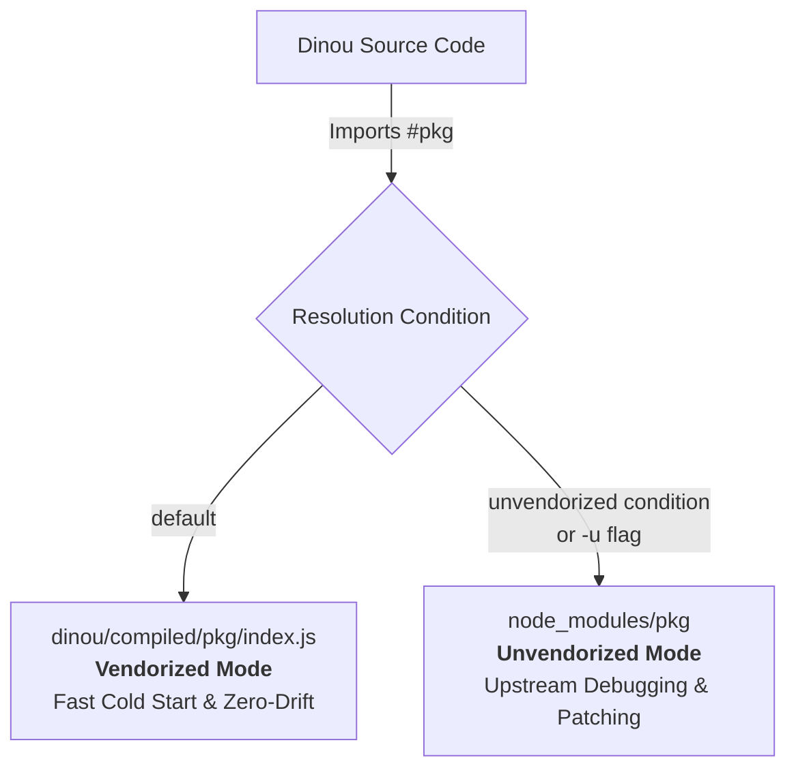

# Dinou v9: Architecture Guide, Dual-Mode Additive Vendoring & Maintainer Manual

This document provides a comprehensive technical overview of the architecture, implementation, and maintenance workflows introduced in **Dinou v9.0.0**. It serves as the official knowledge transfer specification for maintainers, AI coding agents, and documentation writers (`dinou-docs`).

---

## 1. Executive Summary: What is Dinou v9?

**Dinou v9.0.0** introduces a high-performance, zero-drift **Additive Vendoring System** powered by native Node.js **Subpath Imports** (`#...`). 

### Core Problems Solved
1. **Slow Cold Starts & Filesystem Overhead**: Modern bundlers and dev servers spend considerable startup time walking deep `node_modules` trees, loading thousands of small files, parsing CommonJS metadata, and resolving module symlinks.
2. **Upstream Drift & Ghost Breakages**: Transitive upstream dependency bumps can introduce subtle bugs across different machines or CI runners even with lockfiles.
3. **CommonJS/ESM Friction**: Many build-time plugins (Babel transforms, PostCSS plugins, loader utilities) still distribute legacy CJS or malformed dual-packages that require costly runtime interop checks.

### The Dinou v9 Solution
- **Pre-bundled Dependencies (`dinou/compiled/`)**: 36 build-time and internal utility packages are compiled into standalone, optimized ESM modules stored directly in the repository/package.
- **Dual-Mode Resolution (Vendorized by Default / Unvendorized on Demand)**:
  - **Default Mode (Vendorized)**: Imports resolve directly to `dinou/compiled/<pkg>/index.js`, delivering instant cold boots, zero `node_modules` traversal for internal tools, and deterministic behavior.
  - **Unvendorized Mode (`-u` / `--unvendorized`)**: Standard `node_modules/<pkg>` packages are loaded dynamically using Node.js conditional subpath imports, enabling maintainers and developers to inspect, patch, or debug upstream libraries directly in `node_modules`.
- **Additive & Non-Destructive**: All dependencies remain declared in `package.json`. Projects scaffolded with `create-dinou` or running in ejected mode retain full flexibility. Nothing is removed or locked down.
- **Cross-Bundler Symmetry**: Fully validated across **esbuild**, **Rollup**, and **Webpack**, in both standard and ejected layouts.



---

## 2. Developer Guide: Working with Dinou v9 (User Perspective)

From an application developer's perspective, Dinou v9 is completely transparent, zero-friction, and requires no learning curve.

### 2.1. The Default Experience: Maximum Speed, Zero Configuration
When developing or building applications with Dinou, developers run standard commands:
- **Development Server**:
  ```bash
  npm run dev
  # or directly with CLI
  npx dinou dev
  ```
- **Production Builds**:
  ```bash
  npm run build
  # or specific bundler targets
  npm run build:node:esbuild
  ```
- **Production Server**:
  ```bash
  npm start
  # or
  npm run start:node:esbuild
  ```

**What happens automatically**:
- Dinou runs in **Vendorized Mode** by default.
- All internal framework tooling (Babel parser/ast transforms, PostCSS/Tailwind processors, Rollup/Webpack build helpers, file watchers) resolves instantly to pre-compiled, optimized ESM bundles in `dinou/compiled/`.
- The user enjoys ultra-fast cold starts, deterministic behavior across machines, and zero `node_modules` directory-walking overhead without configuring anything.

---

### 2.2. Opting Out of Vendoring: The `-u` (`--unvendorized`) Flag
If a developer needs to debug an upstream dependency, inspect its implementation in `node_modules`, test a patch, or troubleshoot third-party library behavior, Dinou provides a single, uniform opt-out mechanism: the `-u` (or `--unvendorized`) flag.

#### A. In Standard (Non-Ejected) Applications
In standard projects where Dinou is installed as an npm package dependency (`"dinou": "^9.0.0"`), developers can pass the flag via the CLI or npm:

```bash
# Direct CLI invocation
npx dinou dev -u
npx dinou build:node:esbuild -u

# Via npm run (using npm's standard argument forwarding separator '--')
npm run dev -- -u
npm run build:node:esbuild -- -u
npm run start:node:esbuild -- -u
```

#### B. In Ejected Applications
In ejected applications where the framework source code lives directly in `./dinou` and scripts execute via `node dinou/...`:

```bash
# Via npm run (forwarded to the node script)
npm run dev -- -u
npm run build:node:esbuild -- -u
npm run start:node:esbuild -- -u

# Or direct node invocation
node dinou/node/dev.js -u
node dinou/node/build.js -u
node dinou/adapters/node.js -u
```

#### C. Via Environment Variable (CI / Global Session)
For CI/CD pipelines, Docker containers, or developers who prefer not to modify CLI commands, setting the environment variable achieves identical behavior:

```bash
# Linux / macOS / Bash
export DINOU_UNVENDORIZED=true
npm run build:node:esbuild

# Windows PowerShell
$env:DINOU_UNVENDORIZED="true"
npm run build:node:esbuild

# Cross-platform inline
npx cross-env DINOU_UNVENDORIZED=true npm run build:node:esbuild
```

---

### 2.3. Ejected Applications: The `build:vendors` Script
In Dinou's philosophy, developers can eject their application at any time using `dinou eject` to gain full, unrestricted access to the framework codebase inside `./dinou`.

In an ejected Dinou v9 project:
1. The pre-compiled vendor bundles are stored right inside `./dinou/compiled/`.
2. The ejected `package.json` automatically includes the script:
   ```json
   "scripts": {
     "build:vendors": "node dinou/scripts/build-vendors.js"
   }
   ```
3. **When to use it?**
   - If you update a dependency in `package.json` (for example, bumping `@babel/core` or `postcss` to a newer version), your application will use the updated package whenever running with `-u`.
   - If you want your **default vendorized cache** (`./dinou/compiled/`) to also be updated to that new version, you simply run:
     ```bash
     npm run build:vendors
     ```
   - In ~5 seconds, the script re-bundles all 36 vendor packages into `./dinou/compiled/` and updates `./dinou/compiled/vendors-manifest.json`.

---

### 2.4. Developer Quick Reference
| Scenario | Command / Action | What Dinou does |
| :--- | :--- | :--- |
| **Normal development & building** | `npm run dev`<br/>`npm run build` | Runs in **Vendorized Mode** (default). Maximum speed, zero config. |
| **Upstream debugging / inspection** | `npm run dev -- -u`<br/>`npm run build -- -u` | Runs in **Unvendorized Mode**. Resolves dependencies from `node_modules`. |
| **Upgraded packages in ejected app** | `npm run build:vendors` | Re-bundles all packages into local `./dinou/compiled/` with new versions. |

---

## 3. Architecture & Design Principles

### 3.1. The "Additive" Principle
In Dinou v9, vendoring is strictly **additive**:
- Every vendorized package is still listed in `package.json` under `"dependencies"`.
- When a user creates an app via `create-dinou`, npm/bun/pnpm/yarn installs all packages normally into `node_modules`.
- The vendor bundle (`dinou/compiled/`) is distributed alongside the source code.
- If a developer needs to debug an upstream bug in `@babel/traverse`, they don't have to deconstruct the framework—they simply pass the `-u` flag to bypass the compiled bundle and hit `node_modules/@babel/traverse` directly.

### 3.2. Native Node.js Subpath Imports (`#...`)
Dinou uses the standard Node.js [Subpath Imports](https://nodejs.org/api/packages.html#subpath-imports) specification. In `dinou/package.json`, internal dependencies are mapped using the `"imports"` field with conditional branching:

```json
{
  "imports": {
    "#babel/core": {
      "unvendorized": "@babel/core",
      "default": "./compiled/babel-core/index.js"
    },
    "#postcss": {
      "unvendorized": "postcss",
      "default": "./compiled/postcss/index.js"
    },
    "#chokidar": {
      "unvendorized": "chokidar",
      "default": "./compiled/chokidar/index.js"
    }
  }
}
```

#### How Resolution Works:
1. **Default Execution**:
   When Node.js executes `import babel from "#babel/core"`, it evaluates the `imports` conditions in order. Since no custom conditions are specified, it matches `"default"`, loading `./compiled/babel-core/index.js`.
2. **Unvendorized Execution**:
   When Node.js runs with the `--conditions=unvendorized` flag (or when `-u` is passed to the CLI), Node matches the `"unvendorized"` condition first, resolving directly to the npm package `@babel/core` inside `node_modules`.

### 3.3. Transparent CLI Switch (`ensureVendorMode`)
To provide a smooth developer experience, users do not need to memorize verbose Node flags like `node --conditions=unvendorized`. 

Dinou includes a transparent runtime hook in [dinou/core/ensure-vendor-mode.js](file:///c:/Users/roggc/dev/my-dinou-apps/dinou-e2e/dinou/core/ensure-vendor-mode.js):

```js
// dinou/core/ensure-vendor-mode.js
import { spawn } from "node:child_process";

export function ensureVendorMode() {
  const argv = process.argv;
  const isUnvendorizedRequested =
    argv.includes("-u") ||
    argv.includes("--unvendorized") ||
    process.env.DINOU_UNVENDORIZED === "true" ||
    process.env.DINOU_UNVENDORIZED === "1";

  const isAlreadyActive =
    process.execArgv.some((a) => a.includes("unvendorized")) ||
    (process.env.NODE_OPTIONS && process.env.NODE_OPTIONS.includes("unvendorized"));

  if (isUnvendorizedRequested && !isAlreadyActive) {
    const nodeOptions = (process.env.NODE_OPTIONS ? process.env.NODE_OPTIONS + " " : "") + "--conditions=unvendorized";
    const child = spawn(process.execPath, argv.slice(1), {
      stdio: "inherit",
      env: {
        ...process.env,
        NODE_OPTIONS: nodeOptions,
        DINOU_UNVENDORIZED: "true",
      },
    });

    child.on("exit", (code, signal) => {
      if (signal) process.kill(process.pid, signal);
      else process.exit(code ?? 0);
    });

    return false; // Tells the parent process to sleep/wait
  }

  return true;
}
```

Integrated at the top of entrypoints:
- [dinou/node/dev.js](file:///c:/Users/roggc/dev/my-dinou-apps/dinou-e2e/dinou/node/dev.js)
- [dinou/node/build.js](file:///c:/Users/roggc/dev/my-dinou-apps/dinou-e2e/dinou/node/build.js)
- [dinou/esbuild/build.js](file:///c:/Users/roggc/dev/my-dinou-apps/dinou-e2e/dinou/esbuild/build.js)
- [dinou/adapters/node.js](file:///c:/Users/roggc/dev/my-dinou-apps/dinou-e2e/dinou/adapters/node.js)

When invoked with `node dinou/node/dev.js -u`, the parent process detects the flag, transparently spawns a child process with `NODE_OPTIONS="--conditions=unvendorized"`, pipes stdio, and forwards exit codes. The developer simply uses `-u`.

---

## 4. The Vendor Catalog: What Was Compiled & What Was Kept External

Not all packages can or should be vendorized. Dinou v9 implements a strict separation:

### 4.1. The 36 Vendorized Packages
These packages are self-contained JavaScript/TypeScript build tools, AST parsers, transformers, and CLI utilities that benefit most from bundling:

| Category | Vendorized Packages |
| :--- | :--- |
| **Babel AST & Compiler** | `@babel/core`, `@babel/parser`, `@babel/traverse`, `@babel/generator`, `@babel/types`, `@babel/template`, `@babel/preset-react`, `@babel/preset-typescript`, `@babel/plugin-syntax-import-meta`, `babel-plugin-react-compiler` |
| **Rollup Plugins & Tools** | `@rollup/plugin-babel`, `@rollup/plugin-commonjs`, `@rollup/plugin-node-resolve`, `@rollup/plugin-replace`, `@rollup/plugin-json` |
| **Webpack Loaders & Plugins** | `babel-loader`, `css-loader`, `mini-css-extract-plugin`, `copy-webpack-plugin`, `terser-webpack-plugin` |
| **PostCSS & Styling Tools** | `postcss`, `autoprefixer`, `@tailwindcss/postcss`, `postcss-modules-extract-imports`, `postcss-modules-local-by-default`, `postcss-modules-scope`, `postcss-modules-values`, `postcss-value-parser` |
| **Esbuild Utilities** | `@esbuild-plugins/tsconfig-paths` |
| **Dev Server & Utilities** | `chokidar`, `commander`, `dotenv`, `cross-env`, `picocolors`, `ws` |

### 4.2. External Exceptions (Never Vendorized)
The following dependencies must **never** be vendorized into `compiled/`:

1. **Native Platform Binaries & Rust/Go Addons**:
   - `esbuild`: Distributes platform-specific native Go binaries (`esbuild.exe`, `esbuild-darwin`, `esbuild-linux`). Bundling breaks binary resolution.
   - `@swc/core`: Uses native C++/Rust Node-API bindings (`.node` files).
   - `@tailwindcss/oxide*` / `lightningcss*`: Uses pre-compiled Rust native binaries for CSS acceleration.
2. **React Singletons (`peerDependencies`)**:
   - `react` & `react-dom`: Must share a single instance across client and server.
   - `@roggc/react-server-dom-esm`: Must resolve dynamically against the user's active React instance.
3. **Core Bundler Engines**:
   - `webpack` and `rollup`: Heavy orchestration engines that dynamically require user plugins and loaders at runtime.

---

## 5. Deep-Dive: Solved Engineering Challenges

### 5.1. Shared Symbol in Multi-Entrypoint Vendors (`mini-css-extract-plugin`)
**The Problem**:
`mini-css-extract-plugin` has two entry points:
- Plugin: `mini-css-extract-plugin` (used in Webpack `plugins: [new MiniCssExtractPlugin(...)]`)
- Loader: `mini-css-extract-plugin/dist/loader.js` (used in Webpack `module: { rules: [{ loader: MiniCssExtractPlugin.loader }] }`)

Internally, the plugin attaches its compiler configuration to the Webpack loader context using a module-scoped JavaScript `Symbol`:
```js
const pluginSymbol = Symbol("mini-css-extract-plugin");
```
When `index.js` and `loader.js` were bundled independently as separate esbuild targets, each file received its own distinct `Symbol("mini-css-extract-plugin")`. During Webpack compilation, `loader.js` checked `loaderContext[pluginSymbol]`, couldn't find the configuration, and threw:
```
Error: You forgot to add 'mini-css-extract-plugin' plugin
```

**The Solution**:
In [dinou/scripts/build-vendors.js](file:///c:/Users/roggc/dev/my-dinou-apps/dinou-e2e/dinou/scripts/build-vendors.js), multi-entrypoint packages are bundled with code-splitting (`splitting: true`):
```js
if (cfg.multiEntries) {
  await esbuild.build({
    entryPoints: cfg.multiEntries,
    outdir: outDir,
    bundle: true,
    splitting: true, // Enables shared chunk generation
    format: "esm",
    platform: "node",
    banner: { js: BANNER_JS },
    external: cfg.external || [],
  });
}
```
This generates a shared chunk:
`dinou/compiled/mini-css-extract-plugin/chunk-R6DP5ZYM.js`
Both `index.js` and `loader.js` import from this chunk, guaranteeing they share the exact same `pluginSymbol` reference.

### 5.2. Webpack Pitch Loader Export Compatibility
**The Problem**:
Webpack's `loader-runner` inspects loaders for a `pitch` method: `loader.pitch`. When bundling CommonJS loaders into ESM default exports, the pitch function was hidden inside `.default.pitch`. Webpack failed with:
```
Error: Final loader (.../loader.js) didn't return a Buffer or String
```

**The Solution**:
The build script generates a proxy loader wrapper that explicitly extracts and re-exports named loader hooks:
```js
import _loader from "./loader-bundled.js";
export default _loader.default || _loader;
export const pitch = _loader.pitch || _loader.default?.pitch;
export const hotLoader = _loader.hotLoader || _loader.default?.hotLoader;
```

### 5.3. Dynamic `require` and Module Metadata Shim
Bundling CommonJS libraries to ESM in Node.js causes errors when code uses `require`, `__dirname`, or `__filename`.
The build script injects a global banner into all vendor bundles:
```js
const BANNER_JS = `
import { createRequire as __createRequire } from "node:module";
import { fileURLToPath as __fileURLToPath } from "node:url";
import * as __path from "node:path";
const require = __createRequire(import.meta.url);
const __filename = __fileURLToPath(import.meta.url);
const __dirname = __path.dirname(__filename);
`.trim();
```
This ensures 100% CJS compatibility without runtime shims.

### 5.4. CommonJS Wrapper for Dual-Export Libraries
Libraries like `@esbuild-plugins/tsconfig-paths` expose named exports in CommonJS (`exports.TsconfigPathsPlugin = ...`) but do not declare ESM named exports when bundled naively.
The build script inspects exported symbols and creates an ESM wrapper re-exporting both default and named exports:
```js
import _pkg from "./bundle.js";
export default _pkg.default || _pkg;
export const TsconfigPathsPlugin = _pkg.TsconfigPathsPlugin || _pkg.default?.TsconfigPathsPlugin;
```

---

## 6. Repository Migration: Files Updated to Subpath Imports

The following core files in `dinou/` were migrated from bare specifiers (`from "pkg"`) to subpath imports (`from "#pkg"`):

| Subsystem | File Path | Migrated Imports |
| :--- | :--- | :--- |
| **Core Parser** | [dinou/core/parse-exports.js](file:///c:/Users/roggc/dev/my-dinou-apps/dinou-e2e/dinou/core/parse-exports.js) | `#babel/parser`, `#babel/traverse` |
| **Server Functions** | [dinou/core/transform-server-functions.js](file:///c:/Users/roggc/dev/my-dinou-apps/dinou-e2e/dinou/core/transform-server-functions.js) | `#babel/parser`, `#babel/traverse`, `#babel/generator`, `#babel/types`, `#babel/template` |
| **Scoped CSS** | [dinou/core/createScopedName.js](file:///c:/Users/roggc/dev/my-dinou-apps/dinou-e2e/dinou/core/createScopedName.js) | `#postcss-modules-scope` |
| **Esbuild Plugins** | [dinou/esbuild/plugins-esbuild/babel-react-compiler-plugin.js](file:///c:/Users/roggc/dev/my-dinou-apps/dinou-e2e/dinou/esbuild/plugins-esbuild/babel-react-compiler-plugin.js) | `#babel-plugin-react-compiler` |
| **Esbuild CSS** | [dinou/esbuild/plugins-esbuild/css-processor-plugin.js](file:///c:/Users/roggc/dev/my-dinou-apps/dinou-e2e/dinou/esbuild/plugins-esbuild/css-processor-plugin.js) | `#postcss`, `#autoprefixer`, `#tailwindcss/postcss`, `#postcss-modules-...` |
| **Esbuild Config** | [dinou/esbuild/helpers-esbuild/get-config-esbuild-prod.js](file:///c:/Users/roggc/dev/my-dinou-apps/dinou-e2e/dinou/esbuild/helpers-esbuild/get-config-esbuild-prod.js) | `#esbuild-plugins/tsconfig-paths` |
| **Esbuild Entries** | [dinou/esbuild/helpers-esbuild/get-esbuild-entries.js](file:///c:/Users/roggc/dev/my-dinou-apps/dinou-e2e/dinou/esbuild/helpers-esbuild/get-esbuild-entries.js) | `#babel/parser`, `#babel/traverse` |
| **Esbuild HMR** | [dinou/esbuild/react-refresh/esm-hmr/server.js](file:///c:/Users/roggc/dev/my-dinou-apps/dinou-e2e/dinou/esbuild/react-refresh/esm-hmr/server.js) | `#ws` |
| **Rollup Plugins** | [dinou/rollup/rollup.config.js](file:///c:/Users/roggc/dev/my-dinou-apps/dinou-e2e/dinou/rollup/rollup.config.js) | `#rollup/plugin-babel`, `#rollup/plugin-commonjs`, `#rollup/plugin-node-resolve`, `#rollup/plugin-replace`, `#rollup/plugin-json`, `#postcss`, etc. |
| **Rollup Manifest** | [dinou/rollup/rollup-plugins/rollup-plugin-react-client-manifest.js](file:///c:/Users/roggc/dev/my-dinou-apps/dinou-e2e/dinou/rollup/rollup-plugins/rollup-plugin-react-client-manifest.js) | `#babel/parser`, `#babel/traverse` |
| **Rollup HMR** | [dinou/rollup/react-refresh/esm-hmr/server.js](file:///c:/Users/roggc/dev/my-dinou-apps/dinou-e2e/dinou/rollup/react-refresh/esm-hmr/server.js) | `#ws` |
| **Webpack Config** | [dinou/webpack/webpack.config.js](file:///c:/Users/roggc/dev/my-dinou-apps/dinou-e2e/dinou/webpack/webpack.config.js) | `#mini-css-extract-plugin`, `#terser-webpack-plugin`, `#copy-webpack-plugin` |
| **Webpack Entries** | [dinou/webpack/helpers/get-webpack-entries.js](file:///c:/Users/roggc/dev/my-dinou-apps/dinou-e2e/dinou/webpack/helpers/get-webpack-entries.js) | `#babel/parser`, `#babel/traverse` |
| **Adapters & Runners**| [dinou/node/dev.js](file:///c:/Users/roggc/dev/my-dinou-apps/dinou-e2e/dinou/node/dev.js), [dinou/node/build.js](file:///c:/Users/roggc/dev/my-dinou-apps/dinou-e2e/dinou/node/build.js), [dinou/adapters/node.js](file:///c:/Users/roggc/dev/my-dinou-apps/dinou-e2e/dinou/adapters/node.js) | `#chokidar`, `#dotenv`, `#picocolors`, `ensureVendorMode` |

---

## 7. Maintainer's Operating Manual: Keeping Dinou Up to Date

This section explains what maintainers must do when updating dependencies, adding new packages, or preparing a new release.

### 7.1. Updating an Existing Vendor Dependency
When an existing vendor dependency (such as `@babel/core`, `chokidar`, `ws`, or `postcss`) is bumped to a new version:

1. **Update `package.json`**:
   Update the version in `dinou/package.json` under `"dependencies"`:
   ```bash
   npm install @babel/core@latest --save-exact
   ```
2. **Re-run the Vendor Builder**:
   Run the dedicated vendor compilation script:
   ```bash
   npm run build:vendors
   ```
   *(or `node dinou/scripts/build-vendors.js`)*.
3. **What the script does automatically**:
   - Reads the `VENDOR_LIST` catalog in [dinou/scripts/build-vendors.js](file:///c:/Users/roggc/dev/my-dinou-apps/dinou-e2e/dinou/scripts/build-vendors.js).
   - Bundles the updated package with esbuild into `dinou/compiled/<pkg>/index.js`.
   - Generates CJS/ESM interop wrappers and pitch loader proxies where needed.
   - Extracts the exact installed version from `node_modules/<pkg>/package.json` and updates `dinou/compiled/vendors-manifest.json`.
4. **Run the Full Test Suite**:
   Verify both vendorized and unvendorized modes:
   ```bash
   npm run test:contracts
   node --test tests/server-functions-props-and-manifest.test.js
   npm run build:client:esbuild
   npm run build:client:rollup
   npm run build:client:webpack
   ```
5. **Commit the Changes**:
   Commit both `package.json` and the updated `dinou/compiled/` directory.

### 7.2. Adding a New Dependency to the Vendoring System
If you introduce a new build-time library (e.g. a new code analysis tool or minifier `super-parser`) that you want vendorized:

1. **Install the package**:
   ```bash
   npm install super-parser --save-exact
   ```
2. **Register it in `dinou/scripts/build-vendors.js`**:
   Add an entry to the `VENDOR_LIST` array:
   ```js
   {
     name: "super-parser",
     pkgName: "super-parser",
     outDir: "super-parser",
   }
   ```
   *If it has external dependencies (like native binaries or peer dependencies), specify `external: [...]`.*
   *If it has multiple entry points, specify `multiEntries: { index: "...", sub: "..." }`.*
3. **Add the Subpath Import in `dinou/package.json`**:
   Add the mapping under `"imports"`:
   ```json
   "#super-parser": {
     "unvendorized": "super-parser",
     "default": "./compiled/super-parser/index.js"
   }
   ```
4. **Use `#super-parser` in Dinou Source Code**:
   In your internal framework files, import using the hash prefix:
   ```js
   import { parse } from "#super-parser";
   ```
5. **Run the Vendor Builder**:
   ```bash
   npm run build:vendors
   ```
6. **Verify Parity in Both Modes**:
   - Run in default mode: `node dinou/node/dev.js`
   - Run in unvendorized mode: `node dinou/node/dev.js -u`

### 7.3. Troubleshooting & Decision Matrix

```
Is the new package a native binary, Rust addon, or Go executable?
├── YES ──> DO NOT VENDOR. Keep in package.json dependencies and import bare: import x from "pkg"
└── NO
    └── Is it React, ReactDOM, or a peerDependency?
        ├── YES ──> DO NOT VENDOR. Must remain external singleton.
        └── NO
            └── VENDOR IT!
                1. Add to VENDOR_LIST in scripts/build-vendors.js
                2. Add to dinou/package.json imports: "#pkg": { unvendorized: "pkg", default: "./compiled/pkg/index.js" }
                3. Run npm run build:vendors
```

---

## 8. Verification Matrix & Test Coverage

Dinou v9 has undergone validation across all layers:

| Target / Workflow | Vendorized Mode (`default`) | Unvendorized Mode (`-u`) | Status |
| :--- | :--- | :--- | :--- |
| **Esbuild Client Build** | `npm run build:client:esbuild` | `node dinou/esbuild/build.js -u` | ✅ PASSED |
| **Rollup Client Build** | `npm run build:client:rollup` | `--conditions=unvendorized` | ✅ PASSED |
| **Webpack Client Build** | `npm run build:client:webpack`| `--conditions=unvendorized` | ✅ PASSED |
| **Dual-Engine SSG** | 187 pages + 65 layouts pre-rendered | Identical output hash | ✅ PASSED |
| **Node.js Production Server** | `node ./dinou/node/build.js` | `node ./dinou/node/build.js -u` | ✅ PASSED |
| **Playwright Real Browser** | `npm run start:node:esbuild` | `node dinou/adapters/node.js -u` | ✅ PASSED (100% Green) |
| **Contract Duality Tests** | 11/11 contract tests pass | 11/11 contract tests pass | ✅ PASSED |
| **Server Functions Isolation**| 2/2 unit tests pass | 2/2 unit tests pass | ✅ PASSED |

---

## 9. Summary of Subpath Import Map (`dinou/package.json`)

```json
{
  "imports": {
    "#babel/core": { "unvendorized": "@babel/core", "default": "./compiled/babel-core/index.js" },
    "#babel/parser": { "unvendorized": "@babel/parser", "default": "./compiled/babel-parser/index.js" },
    "#babel/traverse": { "unvendorized": "@babel/traverse", "default": "./compiled/babel-traverse/index.js" },
    "#babel/generator": { "unvendorized": "@babel/generator", "default": "./compiled/babel-generator/index.js" },
    "#babel/types": { "unvendorized": "@babel/types", "default": "./compiled/babel-types/index.js" },
    "#babel/template": { "unvendorized": "@babel/template", "default": "./compiled/babel-template/index.js" },
    "#babel/preset-react": { "unvendorized": "@babel/preset-react", "default": "./compiled/babel-preset-react/index.js" },
    "#babel/preset-typescript": { "unvendorized": "@babel/preset-typescript", "default": "./compiled/babel-preset-typescript/index.js" },
    "#babel/plugin-syntax-import-meta": { "unvendorized": "@babel/plugin-syntax-import-meta", "default": "./compiled/babel-plugin-syntax-import-meta/index.js" },
    "#babel-loader": { "unvendorized": "babel-loader", "default": "./compiled/babel-loader/index.js" },
    "#babel-plugin-react-compiler": { "unvendorized": "babel-plugin-react-compiler", "default": "./compiled/babel-plugin-react-compiler/index.js" },
    "#rollup/plugin-babel": { "unvendorized": "@rollup/plugin-babel", "default": "./compiled/rollup-plugin-babel/index.js" },
    "#rollup/plugin-commonjs": { "unvendorized": "@rollup/plugin-commonjs", "default": "./compiled/rollup-plugin-commonjs/index.js" },
    "#rollup/plugin-json": { "unvendorized": "@rollup/plugin-json", "default": "./compiled/rollup-plugin-json/index.js" },
    "#rollup/plugin-node-resolve": { "unvendorized": "@rollup/plugin-node-resolve", "default": "./compiled/rollup-plugin-node-resolve/index.js" },
    "#rollup/plugin-replace": { "unvendorized": "@rollup/plugin-replace", "default": "./compiled/rollup-plugin-replace/index.js" },
    "#esbuild-plugins/tsconfig-paths": { "unvendorized": "@esbuild-plugins/tsconfig-paths", "default": "./compiled/esbuild-tsconfig-paths/index.js" },
    "#css-loader": { "unvendorized": "css-loader", "default": "./compiled/css-loader/index.js" },
    "#mini-css-extract-plugin": { "unvendorized": "mini-css-extract-plugin", "default": "./compiled/mini-css-extract-plugin/index.js" },
    "#mini-css-extract-plugin/loader": { "unvendorized": "mini-css-extract-plugin/dist/loader.js", "default": "./compiled/mini-css-extract-plugin/loader.js" },
    "#copy-webpack-plugin": { "unvendorized": "copy-webpack-plugin", "default": "./compiled/copy-webpack-plugin/index.js" },
    "#terser-webpack-plugin": { "unvendorized": "terser-webpack-plugin", "default": "./compiled/terser-webpack-plugin/index.js" },
    "#postcss": { "unvendorized": "postcss", "default": "./compiled/postcss/index.js" },
    "#autoprefixer": { "unvendorized": "autoprefixer", "default": "./compiled/autoprefixer/index.js" },
    "#tailwindcss/postcss": { "unvendorized": "@tailwindcss/postcss", "default": "./compiled/tailwindcss-postcss/index.js" },
    "#postcss-modules-extract-imports": { "unvendorized": "postcss-modules-extract-imports", "default": "./compiled/postcss-modules-extract-imports/index.js" },
    "#postcss-modules-local-by-default": { "unvendorized": "postcss-modules-local-by-default", "default": "./compiled/postcss-modules-local-by-default/index.js" },
    "#postcss-modules-scope": { "unvendorized": "postcss-modules-scope", "default": "./compiled/postcss-modules-scope/index.js" },
    "#postcss-modules-values": { "unvendorized": "postcss-modules-values", "default": "./compiled/postcss-modules-values/index.js" },
    "#postcss-value-parser": { "unvendorized": "postcss-value-parser", "default": "./compiled/postcss-value-parser/index.js" },
    "#chokidar": { "unvendorized": "chokidar", "default": "./compiled/chokidar/index.js" },
    "#commander": { "unvendorized": "commander", "default": "./compiled/commander/index.js" },
    "#cross-env": { "unvendorized": "cross-env", "default": "./compiled/cross-env/index.js" },
    "#dotenv": { "unvendorized": "dotenv", "default": "./compiled/dotenv/index.js" },
    "#picocolors": { "unvendorized": "picocolors", "default": "./compiled/picocolors/index.js" },
    "#ws": { "unvendorized": "ws", "default": "./compiled/ws/index.js" }
  }
}
```
